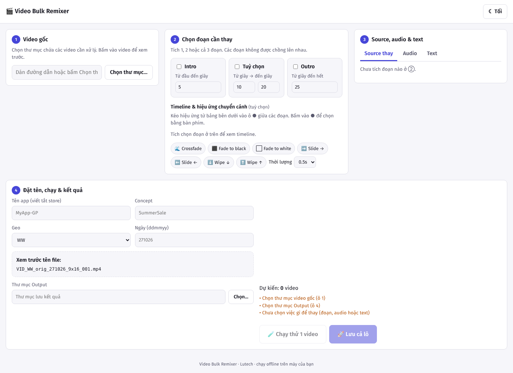
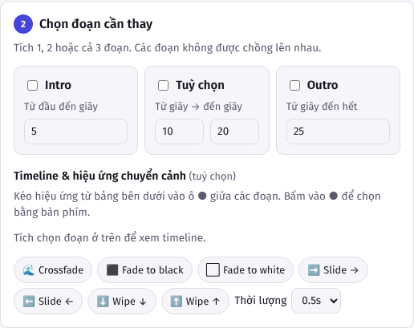
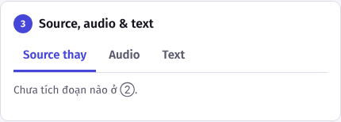
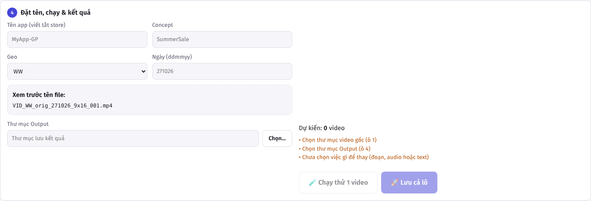

# Hướng dẫn cài đặt và chạy Video Bulk Remixer

Tài liệu này dành cho người không rành máy tính. Làm lần lượt từng bước, trong mỗi bước có ghi rõ nên làm gì nếu gặp lỗi.

Tool chạy hoàn toàn trên máy của bạn, không gửi video lên mạng. Bạn chỉ cần cài một lần, các lần sau nhấp đúp là mở được.

---

## Phần A: Những thứ cần có trước

| Thứ cần có | Dùng để làm gì | Ghi chú |
|---|---|---|
| **Python 3.12** | Chạy chính tool | Không dùng Python 3.9 (có sẵn trên Mac) hoặc 3.14 trở lên, vì thư viện chưa hỗ trợ. |
| **ffmpeg + ffprobe** | Đọc, cắt, ghép video | Hai file này nằm trong thư mục `bin/`. Hướng dẫn tải ở phần B và C. |
| Khoảng 2 GB dung lượng trống | Thư viện và file tạm | Thư viện cài trong thư mục `.venv`. |
| Kết nối mạng (lần đầu) | Tải thư viện và ffmpeg | Sau khi cài xong có thể chạy không cần mạng. |

Bạn sẽ dùng thư mục `VideoRemixer-main` (hoặc `VideoRemixer-main 2` nếu máy đã có bản cũ). Từ đây trở đi, hướng dẫn gọi chung là **thư mục tool**.

---

## Phần B: Hướng dẫn cho macOS

### Bước B1. Tải và giải nén tool
1. Tải file `VideoRemixer-main.zip` (từ GitHub hoặc file được gửi).
2. Nhấp đúp file zip để giải nén. Bạn sẽ có thư mục `VideoRemixer-main` trong **Downloads**.
3. Nếu máy đã có thư mục cũ, đổi tên hoặc xoá thư mục cũ trước. Nếu có file ffmpeg cũ trong thư mục `bin`, hãy chép ra chỗ khác để dùng lại.

### Bước B2. Kiểm tra Mac có dùng chip Apple không
1. Bấm biểu tượng quả táo  ở góc trên bên trái → **Giới thiệu về máy Mac này**.
2. Nếu thấy dòng **Chip: Apple M1/M2/M3/M4** thì là chip Apple (arm64). Nếu thấy **Processor: Intel** thì là Intel (x86_64).
3. Ghi nhớ kết quả, bạn sẽ cần nó ở bước B5.

### Bước B3. Cài Python 3.12
1. Mở trình duyệt, vào https://www.python.org/downloads/macos/
2. Chọn bản **Python 3.12.x** (không chọn bản mới nhất nếu đó là 3.13 trở lên, vì để an toàn nên dùng 3.12).
3. Tải file `.pkg` và nhấp đúp để cài. Làm theo các bước, nhập mật khẩu Mac khi được hỏi.
4. Cài xong, mở **Terminal** (tìm bằng Spotlight: bấm Cmd + Space rồi gõ `Terminal`), gõ:
   ```
   python3.12 --version
   ```
   Kết quả phải là `Python 3.12.x`.

**Nếu lỗi:** Nếu không có bản 3.12, có thể bạn đã cài nhầm. Cài thêm 3.12 không làm mất bản đang có.

### Bước B4. Cài chứng chỉ bảo mật cho Python
Đây là bước bắt buộc với bản Python từ python.org, nếu bỏ qua thì bước tải ffmpeg sẽ báo lỗi `CERTIFICATE_VERIFY_FAILED`.

1. Mở Finder, vào **Applications** (Ứng dụng) → thư mục **Python 3.12**.
2. Nhấp đúp file **Install Certificates.command**. Chờ cửa sổ Terminal chạy xong và tự đóng.

### Bước B5. Cài Rosetta (chỉ với chip Apple)
Bỏ qua bước này nếu máy là Intel.

Mở Terminal và gõ:
```
softwareupdate --install-rosetta --agree-to-license
```
Nếu hiện thông báo đã cài rồi thì không sao. Lệnh này có thể mất vài phút.

### Bước B6. Tải ffmpeg và ffprobe
Có hai cách, chọn một.

**Cách 1 (tự động, khuyên dùng với Intel):**
1. Mở Terminal, gõ `cd ` (có dấu cách cuối), kéo thư mục tool (VideoRemixer-main) vào cửa sổ Terminal rồi Enter.
2. Gõ:
   ```
   python3.12 -m venv .venv && .venv/bin/python -m pip install --upgrade pip && .venv/bin/python -m pip install . && .venv/bin/python scripts/fetch_ffmpeg.py
   ```
3. Đợi đến khi thấy các dòng `→ Tải ...` kết thúc không báo lỗi.

**Cách 2 (tải tay, khuyên dùng với chip Apple M):**
1. Vào https://ffmpeg.martin-riedl.de và tải bản **macOS arm64** cho `ffmpeg` và `ffprobe`. Mỗi file tải về là một file zip. Nếu trang này không mở được, dùng Cách 1.

   Nếu tải không được bản arm64, có thể dùng bản Intel từ evermeet.cx (chạy được nhờ Rosetta, nhưng chậm hơn).
2. Nhấp đúp để giải nén, bạn sẽ có hai file `ffmpeg` và `ffprobe`.
3. Trong thư mục tool, tạo thư mục `bin` nếu chưa có, rồi kéo hai file vào đó.
4. Mở Terminal, kéo thư mục tool vào Terminal rồi gõ:
   ```
   chmod +x bin/ffmpeg bin/ffprobe && xattr -dr com.apple.quarantine bin
   ```

**Cách 2 cũng dùng được cho Intel** (tải từ https://evermeet.cx/ffmpeg/ thay cho trang trên).

### Bước B7. Kiểm tra ffmpeg
Trong Terminal (đang ở thư mục tool), gõ:
```
./bin/ffmpeg -version
```
Nếu hiện dòng `ffmpeg version ...` là đã sẵn sàng. Nếu hiện `killed` hoặc `Bad CPU type`, quay lại bước B5 hoặc chọn bản đúng với chip của máy.

### Bước B8. Chạy tool
1. Nhấp đúp file **RUN-Mac.command** trong thư mục tool.
2. Lần đầu sẽ cài thư viện khoảng vài phút. Đợi đến khi thấy dòng:
   `Video Bulk Remixer đang chạy: http://127.0.0.1:8765/?t=...`
3. Copy nguyên dòng link đó, dán vào Safari hoặc Chrome để mở giao diện.
4. **Đừng đóng cửa sổ Terminal** khi đang dùng tool. Muốn tắt tool thì bấm Ctrl + C trong cửa sổ đó.

**Nếu macOS báo không mở được file:** chuột phải file RUN-Mac.command, chọn **Open**, rồi bấm **Open** trong hộp thoại.

**Lần sau:** chỉ cần nhấp đúp RUN-Mac.command, không cần cài lại.

---

## Phần C: Hướng dẫn cho Windows

**Lưu ý:** phần này mình chưa kiểm tra trực tiếp trên máy Windows. Nếu gặp lỗi chỗ nào, chụp màn hình và gửi lại để sửa.

### Bước C1. Tải và giải nén tool
1. Tải file `VideoRemixer-main.zip`.
2. Chuột phải file zip → **Extract All** (Giải nén tất cả). Chọn thư mục đích, ví dụ `Downloads`.
3. Bạn sẽ có thư mục `VideoRemixer-main`.

### Bước C2. Cài Python 3.12
1. Vào https://www.python.org/downloads/windows/ và tải **Python 3.12.x** (installer 64-bit).
2. Mở file vừa tải. **Quan trọng:** tích ô **Add python.exe to PATH** ở dưới cùng cửa sổ đầu tiên.
3. Chọn **Install Now**, đợi xong.
4. Kiểm tra: mở **Command Prompt** (tìm `cmd` trong Start), gõ `py -3.12 --version`. Kết quả phải là `Python 3.12.x`.

**Nếu lỗi:** chưa tích ô PATH thì gỡ Python rồi cài lại và tích ô đó.

### Bước C3. Tải ffmpeg và ffprobe
**Cách 1 (tự động):**
1. Mở Command Prompt, gõ `cd ` (có dấu cách cuối), kéo thư mục tool vào cửa sổ rồi Enter.
2. Gõ:
   ```
   py -3.12 -m venv .venv && .venv\Scripts\python.exe -m pip install --upgrade pip && .venv\Scripts\python.exe -m pip install . && .venv\Scripts\python.exe scripts\fetch_ffmpeg.py
   ```
3. Khi xong, thư mục `bin` sẽ có `ffmpeg.exe` và `ffprobe.exe`.

**Cách 2 (tải tay, nếu cách 1 lỗi mạng):**
1. Vào https://www.gyan.dev/ffmpeg/builds/ và tải **ffmpeg-release-essentials.zip**.
2. Giải nén. Trong thư mục `bin` bên trong có `ffmpeg.exe` và `ffprobe.exe`.
3. Copy hai file này vào thư mục `bin` của tool (tạo thư mục `bin` nếu chưa có).

### Bước C4. Chạy tool
1. Nhấp đúp file **RUN-Windows.bat** trong thư mục tool.
2. Nếu Windows hỏi quyền truy cập, chọn **Yes** hoặc **Cho phép**.
3. Lần đầu sẽ cài thư viện khoảng vài phút. Đợi đến khi thấy dòng `Video Bulk Remixer đang chạy: http://127.0.0.1:8765/?t=...`.
4. Copy link đó, dán vào Chrome hoặc Edge.
5. Không đóng cửa sổ đen khi đang dùng tool. Muốn tắt thì bấm Ctrl + C trong cửa sổ đó.

**Nếu Windows SmartScreen chặn:** bấm **More info** (Thêm thông tin) → **Run anyway** (Vẫn chạy).

---

## Phần D: Dùng nhanh tool (áp dụng cho cả hai máy)

Giao diện có 4 khu vực. Làm theo thứ tự.



1. **Video gốc:** bấm **Chọn thư mục…** và chọn thư mục chứa video gốc. Bấm vào một video để xem trước.

   

2. **Chọn đoạn cần thay:** tích Intro, Tuỳ chọn hoặc Outro. Ô nào không hợp lệ sẽ báo đỏ.

   

3. **Source, audio, text:** chọn thư mục clip thay thế, audio và chữ cần thay (nếu có).

   

4. **Đặt tên, chạy và kết quả:**
   - Điền tên app, concept, geo, ngày. Khung **Xem trước tên file** cho biết tên file sẽ được đặt.
   - Chọn thư mục đầu ra.
   - Bấm **🧪 Chạy thử 1 video** trước. Khi xong, bấm **Xem** ở dòng kết quả để kiểm tra.
   - Nếu ổn, bấm **🚀 Lưu cả lô** để chạy toàn bộ.

   

**Mẹo để chạy nhanh hơn:**
- Chạy thử trước để tránh phải làm lại cả lô.
- Đóng các ứng dụng nặng khác khi đang xử lý.
- Cắm nguồn điện, không để máy ngủ.

---

## Phần E: Xử lý lỗi thường gặp

| Thông báo trên màn hình hoặc Terminal | Nguyên nhân | Cách sửa |
|---|---|---|
| `không tìm thấy ffmpeg trong bin/` | Chưa có ffmpeg hoặc thiếu ffprobe | Làm lại phần B6 (Mac) hoặc C3 (Windows). Kiểm tra có đủ hai file. |
| `CERTIFICATE_VERIFY_FAILED` | Python thiếu chứng chỉ | Chạy lại Install Certificates.command (bước B4). |
| `Failed building wheel for pillow` hoặc `pydantic-core` | Đang dùng Python quá mới (3.14 trở lên) | Cài Python 3.12 rồi xoá thư mục `.venv` và chạy lại. |
| `No module named 'fastapi'` | Thư viện chưa cài xong | Xoá thư mục `.venv`, nhấp đúp lại file chạy. |
| `killed` khi chạy ffmpeg (Mac) | Chưa có Rosetta, hoặc file bị macOS chặn | Làm lại bước B5 và lệnh `xattr` ở B6. |
| Video báo "Không đọc được" | ffmpeg không chạy được | Kiểm tra lại bước B7 hoặc C3. |
| Tool chạy rất chậm (Mac) | ffmpeg chạy qua Rosetta | Dùng bản arm64 cho chip Apple (bước B6, cách 2). |

**Khi cần hỗ trợ:** chụp màn hình cửa sổ Terminal (Mac) hoặc Command Prompt (Windows), chụp cả dòng lỗi màu đỏ cuối cùng, rồi gửi kèm.

---

## Phần F: Xoá để cài lại từ đầu

1. Xoá thư mục `.venv` trong thư mục tool.
2. Giữ thư mục `bin` nếu ffmpeg vẫn tốt, hoặc xoá nếu muốn tải lại.
3. Làm lại từ phần B hoặc C.
